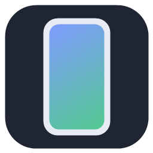
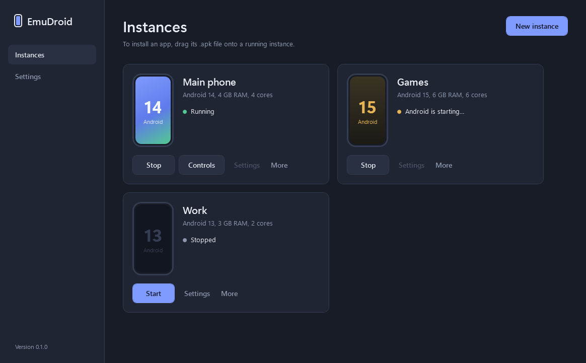
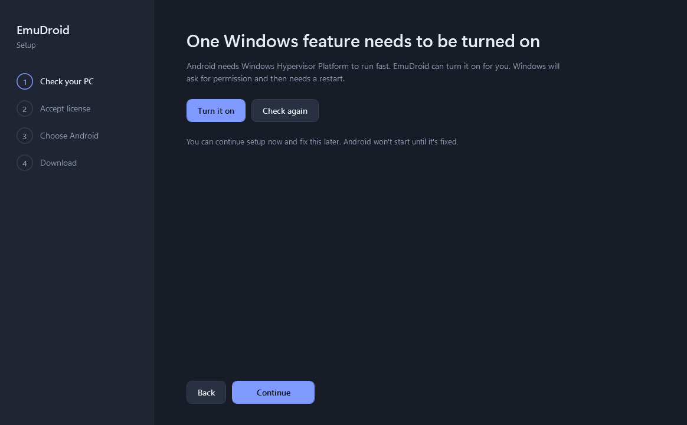
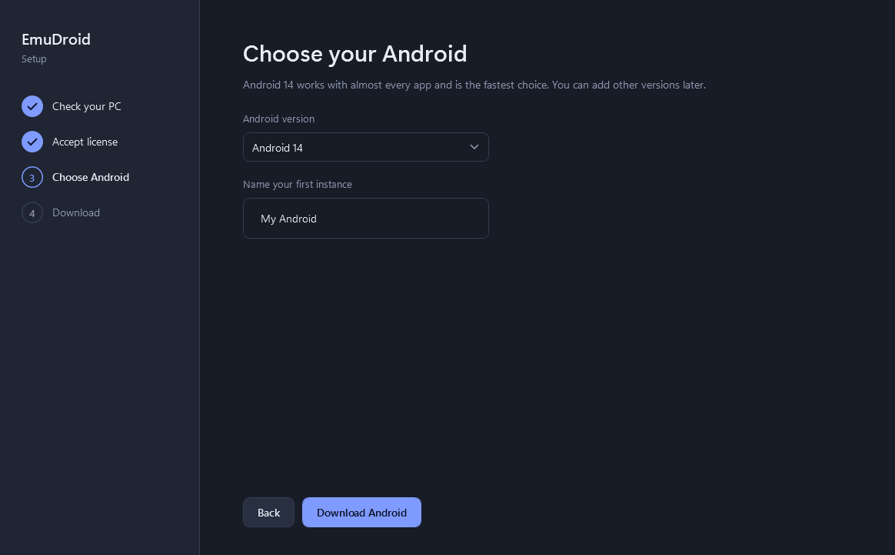

<p align="center">
  
</p>

<h1 align="center">EmuDroid</h1>

<p align="center">
  Run Android apps and games on your Windows PC, with Google Play.
</p>

<p align="center">
  <a href="https://github.com/danilomitic/EmuDroid-Android-Emulator/releases/latest"><b>Download EmuDroid-Setup.exe</b></a>
</p>



EmuDroid is a friendly launcher built on top of the **official Google Android Emulator**. It checks your PC, downloads Android with Google Play straight from Google, and gives you a simple place to run it, with the extras you'd expect:

- **Google Play built in.** Sign in with your Google account and install apps like on a phone.
- **Pick your Android.** Android 12, 13, 14, 15 or 16. Android 14 is the default.
- **Several phones at once.** Each instance has its own apps, accounts and settings. Clone one in a click.
- **Drag & drop apps.** Drop an `.apk`, `.apks` or `.xapk` file on a running instance to install it.
- **Keyboard & mouse controls for games.** Map keys to taps, WASD to a joystick, the mouse to aim and fire.
- **Updates itself.** EmuDroid checks GitHub for new versions and installs them for you.

## Install

1. Download **EmuDroid-Setup.exe** from the [latest release](https://github.com/danilomitic/EmuDroid-Android-Emulator/releases/latest).
2. Run it. Windows may say *"Windows protected your PC"* because the installer isn't code-signed yet. Click **More info → Run anyway**.
3. Follow the setup. EmuDroid checks your PC, asks you to accept Google's Android SDK License, and downloads Android (about 2 GB).
4. Press **Start** on your instance. The first start takes a minute or two. Then sign in to Google Play.

No administrator rights are needed, except once if Windows Hypervisor Platform has to be turned on (see below).

| Setup | Choosing Android |
|---|---|
|  |  |

## System requirements

| | Minimum | Recommended |
|---|---|---|
| Windows | 10 (version 1809) 64-bit | 11 64-bit |
| Processor | Intel or AMD with virtualization (VT-x / AMD-V) | 4+ cores |
| Memory | 8 GB RAM | 16 GB RAM |
| Disk | 10 GB free | 20 GB free (SSD) |
| Graphics | DirectX 11 / OpenGL 3.3 | Recent GPU driver |

**Hardware acceleration is required.** EmuDroid uses *Windows Hypervisor Platform*. If it's off, the setup offers to turn it on (Windows asks for permission, then restarts). If virtualization is turned off in your BIOS/UEFI, EmuDroid shows step-by-step instructions for your processor.

## Using EmuDroid

**Install an app from a file.** Start an instance, then drag the `.apk`, `.apks` or `.xapk` file onto its card (or anywhere in EmuDroid when only one instance is running).

**Keyboard & mouse controls.** While an instance is running, click **Controls**. A toolbar appears over Android:

- **Add key**: place a circle on a button in the game, click it and press a key.
- **Add joystick**: place it on the game's movement stick. W/A/S/D move it.
- **Add aim** and **Add fire**: right-click turns aim mode on and off. In aim mode the mouse turns the camera and left-click fires.
- **Only for this app**: save the layout for the current game only. Otherwise it becomes your default layout.

Press **F12** to turn the controls on or off while playing. Controls only react while the emulator window is in front, so typing in other programs is never affected.

**Several instances.** Click **New instance**, or use **More → Clone** to copy an existing one with all its apps and accounts.

## FAQ

**Is this legal? Where does Android come from?**
EmuDroid doesn't include any Google software. The Android Emulator, platform tools and Android system images are downloaded directly from Google's servers (`dl.google.com`) after you accept Google's Android SDK License, the same way Android Studio does it.

**Does it work with games that need ARM?**
Google's Android 11+ images include ARM translation, so most ARM-only apps run. A few games with strict anti-cheat may still refuse to start in any emulator.

**Can I use EmuDroid together with BlueStacks, VirtualBox or WSL?**
Yes. Windows Hypervisor Platform is the same technology those tools use on modern Windows, so they can run side by side.

**Where are my files?**
Everything lives in `%LocalAppData%\EmuDroid`: Android versions in `sdk`, instances in `avd`, control layouts in `keymaps`, logs in `logs`. Uninstalling asks whether to keep or delete them.

## Troubleshooting

| Problem | Fix |
|---|---|
| "Hardware acceleration is not available" | Settings → *Your PC* → **Turn on Windows Hypervisor Platform**, then restart. If it says *Virtualization is off in BIOS*, follow the steps shown there. |
| Black or flickering Android screen | Instance → **Settings** → Graphics: **Software**. Update your GPU driver. |
| Download stopped | Press **Start** or **Download** again. Finished parts are kept, so it continues where it stopped. |
| An app won't install | The message explains why (for example: needs a newer Android, or a different version is already installed). |
| Something else | Settings → **Open logs**, and attach the newest log to a [new issue](https://github.com/danilomitic/EmuDroid-Android-Emulator/issues). |

## Build from source

Requirements: Windows 10/11, [.NET 8 SDK](https://dotnet.microsoft.com/download/dotnet/8.0), and [Inno Setup 6](https://jrsoftware.org/isinfo.php) for the installer.

```bash
dotnet build EmuDroid.sln
dotnet test EmuDroid.sln
dotnet run --project src/EmuDroid.App
```

Build the installer:

```bash
dotnet publish src/EmuDroid.App -c Release -r win-x64 --self-contained true -p:PublishSingleFile=true -p:IncludeNativeLibrariesForSelfExtract=true -p:EnableCompressionInSingleFile=true -o publish
"C:\Program Files (x86)\Inno Setup 6\ISCC.exe" /DAppVersion=1.0.0 installer\EmuDroid.iss
```

Releases are automatic: update `<Version>` in `Directory.Build.props` and `CHANGELOG.md`, then push a tag such as `v1.0.0`. GitHub Actions builds `EmuDroid-Setup.exe`, adds a SHA-256 checksum, and publishes the release.

### Project layout

| Folder | What's inside |
|---|---|
| `src/EmuDroid.App` | WPF app: setup wizard, instances, settings |
| `src/EmuDroid.Core` | Google SDK catalog and downloader, instance (AVD) manager, ADB, system checks, updater |
| `src/EmuDroid.Keymap` | Keyboard & mouse controls: overlay, input hooks, touch over the emulator's gRPC API |
| `tests/EmuDroid.Tests` | Unit tests |
| `installer` | Inno Setup script |

## Disclaimer

Android and Google Play are trademarks of Google LLC. EmuDroid is an independent open-source project and is not affiliated with, endorsed by, or sponsored by Google. EmuDroid does not include or redistribute Google software; it downloads it from Google on your behalf after you accept the Android SDK License.

## License

EmuDroid's own code is released under the [MIT License](LICENSE). `src/EmuDroid.Keymap/Protos/emulator_touch.proto` is derived from the Android Open Source Project (Apache 2.0).
